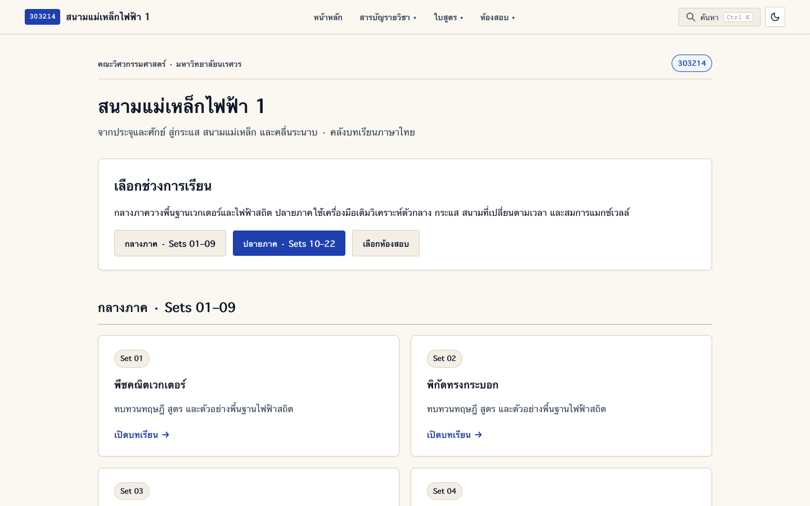
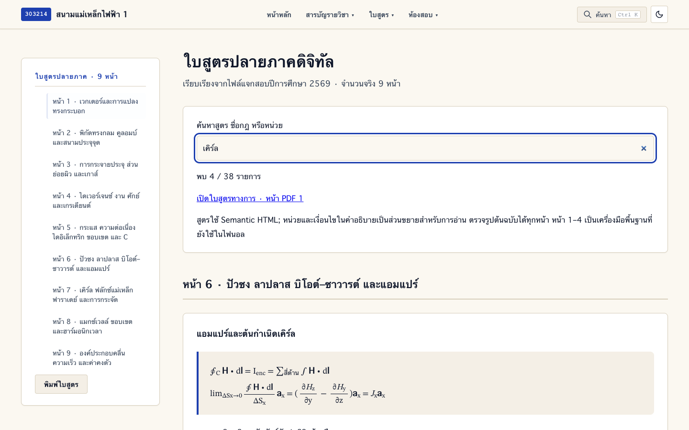
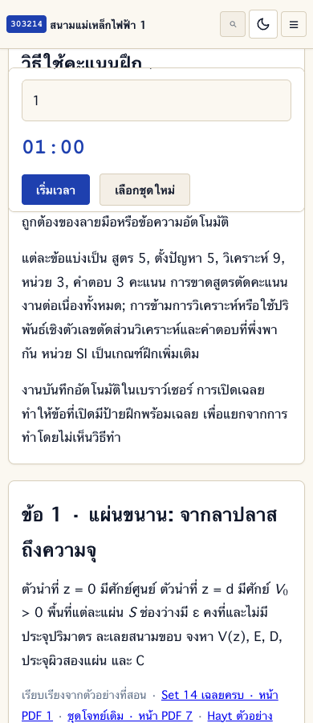
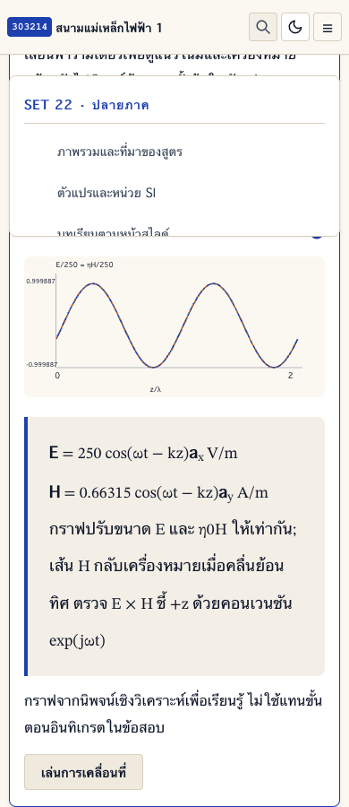

# หลักฐาน QA ปลายภาค

ตรวจเมื่อ 12 ตุลาคม 2569 ด้วย Chromium ผ่าน Playwright และตัวตรวจไฟล์ในโครงการ

## ผลตรวจ

- ตรวจหน้า HTML ทั้งหมด 28 หน้า ที่ความกว้าง 1440 และ 390 พิกเซล
- ตรวจหน้าที่แก้เพิ่มเติมและหน้าสำคัญที่ 320, 390, 900 และ 1440 พิกเซล รวมผลสังเกตล่าสุด 70 รายการ
- Sidebar ใช้ sticky ที่ 84px เมื่อหัวเว็บสูง 60px; รวมแถบสอบกลางภาคบนมือถือและเมื่อขยาย
- ไม่พบหน้าล้นแนวนอน ข้อความตัวห้อยดิบ สมการแบบ Flex หรือ padding ผิดในกล่องที่ตรวจ
- ภาพสไลด์เปิดได้จริง รวมการเปิดหน้าเคิร์ลที่มีดีเทอร์มิแนนต์
- ผ่านการใช้งานห้องสอบ 21 รายการ: การเลือกชุด คะแนนแบบมีเงื่อนไข งานที่บันทึก การเปิดเฉลย ใบสูตรในห้องสอบ ปุ่ม Escape เวลา การพัก/กู้คืน หมดเวลา ส่งออก และการค้นหาจากโฟลเดอร์ซ้อน
- สื่อคลื่นเปลี่ยนพารามิเตอร์และเล่น/พักการเคลื่อนที่ได้
- ไม่พบข้อผิดพลาด JavaScript ในผลตรวจสุดท้าย
- ตัวตรวจไฟล์ยืนยันบทหลัก 242 หน้า เอกสารประกอบ 54 หน้า ภาพต้นฉบับ 305 ภาพ และลิงก์ท้องถิ่นครบ
- สอบทานค่าตัวเลขอิสระกับคำตอบ Drill ได้แก่ D5.1, D6.1, D7.5, D7.6, D8.8, D9.3, D9.4 และตัวอย่างคลื่น

## ไฟล์ผลตรวจ

- [ผล layout ล่าสุด](browser-results.json): รวมผลทุกหน้าและการตรวจซ้ำเฉพาะจุด ผลล่าสุดแทนผลก่อนหน้าของหน้าและขนาดจอเดียวกัน
- [ผลสี่ขนาดจอ](final-probe.json)
- [ผลการใช้งาน 21 รายการ](functional-results.json)
- [ตัวตรวจไฟล์และค่าตัวเลข](../../scripts/verify-final.py)

ผลตรวจนี้ยืนยันการทำงานและการแสดงผลของแพลตฟอร์ม ไม่รับรองจำนวนข้อหรือคะแนนย่อยของข้อสอบที่จะออกจริง Checklist ยังคงเป็นการตรวจงานด้วยตนเอง

## ภาพตัวอย่างที่ตรวจด้วยสายตา

